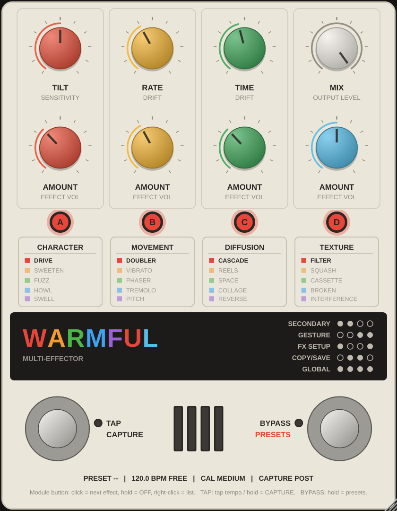
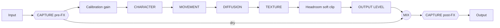

# WARMFUL

A free, non-commercial VST3 / LV2 / AU / Standalone plug-in that behaviourally replicates the
**Hologram Electronics Chroma Console** multi-effect pedal: 4 re-orderable modules × 5 effects,
TILT/RATE/TIME/MIX + 4 AMOUNT knobs, the secondary layer (SENSITIVITY, DRIFT, EFFECT VOL, OUTPUT
LEVEL), GESTURE knob recording, CAPTURE looper/sustainer, input calibration, DUAL BYPASS, bypass
with trails, tap tempo, 80 user presets and the pedal's full MIDI implementation chart.

<p align="center"></p>

> WARMFUL is an independent fan project. It is not affiliated with, endorsed by or derived from
> Hologram Electronics' firmware. "Chroma Console" and "Hologram" are trademarks of their owner and
> are used here only to describe what the plug-in emulates.

## What is (and isn't) replicated

The Chroma Console is a digital pedal (24-bit / 48 kHz DSP, +8 dBu max input). There is no analog
circuit to trace and its firmware is closed, so WARMFUL is a **clean-room behavioural model** built
from the official manual (firmware v1.04) and the character of the gear each effect references. Every
tunable constant sits in a `namespace voicing { … }` block at the top of each effect so it can be
matched against a real unit with the measurement kit in [`tools/measure`](tools/measure/README.md).

| Module | Knobs | Effects |
|---|---|---|
| CHARACTER (red) | TILT · AMOUNT · *SENSITIVITY · EFFECT VOL* | DRIVE, SWEETEN, FUZZ, HOWL, SWELL |
| MOVEMENT (yellow) | RATE · AMOUNT · *DRIFT · EFFECT VOL* | DOUBLER, VIBRATO, PHASER, TREMOLO, PITCH |
| DIFFUSION (green) | TIME · AMOUNT · *DRIFT · EFFECT VOL (wet only)* | CASCADE, REELS, SPACE, COLLAGE, REVERSE |
| TEXTURE (blue) | AMOUNT · *EFFECT VOL* | FILTER (Tilt/LPF/HPF), SQUASH, CASSETTE, BROKEN, INTERFERENCE |
| Global | MIX · *OUTPUT LEVEL* | |

Signal flow (default order, re-orderable in FX SETUP):



## Installing

**Windows 10/11 (x64):** download `WARMFUL-<version>-Windows-Setup.exe` from
[Releases](https://github.com/danisotosol/WARMFUL/releases) and run it. The installer lets you pick

- the components: VST3 plug-in, standalone app, documentation + measurement kit;
- the app folder (default `C:\Program Files\WARMFUL`);
- the VST3 folder (default `C:\Program Files\Common Files\VST3`, or any folder your DAW scans);
- a per-user install without administrator rights (VST3 then defaults to `%LOCALAPPDATA%\Programs\Common\VST3`).

It remembers your folders for upgrades and removes everything it installed from *Apps & features*.
The installer is not code-signed, so SmartScreen may warn: *More info → Run anyway*. Silent install:
`WARMFUL-…-Setup.exe /VERYSILENT /COMPONENTS=vst3,standalone /DIR="C:\WARMFUL" /VST3DIR="D:\VST3"`.

**Linux / macOS:** build from source (below) and copy the bundle to `~/.vst3` / `~/.lv2` or
`~/Library/Audio/Plug-Ins/VST3`.

## Using it (pedal → plug-in)

| On the pedal | In WARMFUL |
|---|---|
| Tap a module button | Click the A–D button (next effect); click an effect name to jump to it; right-click for a list |
| Hold a module button (effect OFF) | Hold the A–D button ~0.6 s |
| A+B: SECONDARY | Click **SECONDARY** in the black strip (knobs turn teal); right-click = reset secondaries |
| C+D: GESTURE | Click **GESTURE**, move knobs, click again (or BYPASS) to loop them; right-click = delete all |
| A+D: FX SETUP | Click **FX SETUP**: routing, dual bypass, capture routing, filter style, expression |
| B+C: COPY/SAVE | Click **COPY/SAVE**, pick a slot (banks A–D × 20), SAVE |
| A+B+C+D: GLOBAL | Click **GLOBAL**: calibration (manual or AUTO), bypass mode, MIDI channel, tempo sync |
| TAP footswitch | Click = tap tempo, hold = CAPTURE (release to loop), click while looping = stop |
| BYPASS footswitch | Click = bypass (DUAL BYPASS group if configured, double click = whole pedal), hold = preset browser |
| Calibration (both footswitches) | GLOBAL → AUTO CALIBRATE, then play normally for ~3 s |

Calibrate first: the drive, compression and saturation thresholds depend on it, exactly as on the
pedal. Levels: LOW +18 dB, MEDIUM +12 dB, HIGH +6 dB, VERY HIGH 0 dB of internal gain (a DI guitar
peaking around −18 dBFS sits at MEDIUM). Start with MIX at 100 % as the manual recommends.

Tempo: **Free** (knobs set absolute rates/times), **Tap** (the TAP footswitch, quantised subdivisions
for VIBRATO, PHASER, TREMOLO, CASCADE, REELS, COLLAGE, REVERSE), or **Host** (DAW tempo).

### MIDI (same chart as the pedal, channel 1 by default)

| Function | Message |
|---|---|
| TILT, AMOUNT (CHAR), RATE, AMOUNT (MOVE), TIME, AMOUNT (DIFF), MIX, AMOUNT (TEX) | CC 64–71 |
| SENSITIVITY, VOL (CHAR), DRIFT (MOVE), VOL (MOVE), DRIFT (DIFF), VOL (DIFF), OUTPUT LEVEL, VOL (TEX) | CC 72–79 |
| Effect select per module (0–21, 22–43, 44–65, 66–87, 88–109, OFF 110–127) | CC 16–19 |
| Bypass / Dual bypass / Module bypass | CC 91 / CC 92 / CC 103–106 |
| Gesture play·rec / erase | CC 80 / CC 81 |
| Capture stop·play·record / routing | CC 82 / CC 83 |
| Filter mode / Tap / Calibration level / Calibration (auto) | CC 84 / CC 93 / CC 94 / CC 95 |
| User presets A1…D20 | Program Change 0–79 |

User presets live in `~/.config/WARMFUL/user_presets.xml` (Linux), `~/Library/Application Support/WARMFUL/`
(macOS) or `%APPDATA%\WARMFUL\` (Windows) and are shared by every instance, like the pedal's memory.
CAPTURE loops are not stored, as on the pedal.

### Factory presets: 50 sounds in 7 packs

Each pack is built from publicly documented sources (interviews, credits, rig rundowns) and is
**inspired by** the artist, not endorsed by them. Every piece of a rig is mapped onto the module that
plays its role, including the module order. Three ways to load them:

- the **preset bar** under the footswitches: ◀ ▶ step through them, click the name to open the browser;
- the **FACTORY** tab of the preset browser, one sub-tab per pack (also: hold the BYPASS footswitch);
- your DAW's preset/program menu (entry 0 "(current settings)" is a no-op, so a host never resets a project).

Load one, tweak it, and COPY/SAVE it into a user slot. All of them assume MEDIUM calibration and are
level-matched to within 1 dB of the dry signal. The version is shown under the logo (e.g. `v0.3.0`).

| Pack | Sources it is built from | Presets |
|---|---|---|
| **MK.GEE** (MKG) | 24" Jaguar on baritone flatwounds into a Tascam 424 preamp, DigiTech Drop, CE-2W vibrato, Rainger Reverb-X before the preamp, MOOD, VG-8, Quadraverb, DD-20 | 424 Edge, Portastudio Crush, Baritone Drop, Distorted Room, Dream Wobble, Bowed Pad, Mood Smear, Rockman Clean, Two Star Lead, Quadraverb Grain |
| **DIJON** (DIJ) | *Absolutely*: one omni C414 in a boxy room through a hot 73-style preamp, mids cut; *Baby*: fuzz guitar, reversed/gated parts, defective-deck skips, huge reverbs; Fairfield Shallow Water; Mk.gee's Reverb-X and BF-2 in his band | Omni Room, Big Mike's Swell, Shallow Water, Lightning Riff, Yamaha Fuzz, Fever Storm, Gated Rewind, Gated Bootleg, Busted Deck, Freak It Echo |
| **PRINCE** (PRN) | MadCat into a clean Mesa Mark II; DS-1/SD-1, BF-2 (Rate 3, Res 10), CE-2, DM-2, OC-2; "Kiss" guitar dry and gated to the hi-hat with a little tape delay; "Purple Rain" clean edge into plate/hall | Crazy Flange Solo, Doves Octave Fuzz, Kiss Gate, Purple Rain Chords, Rain Solo, Nonlin Stab, DI Rhythm CE-2 |
| **BLUNT** (BLT) | tape-recorded, overdubbed and looped records; reverb-washed jangle (*Black Metal*), granular loops and whole-mix phasing (*Black Metal 2*), pirate-radio grit (Babyfather), Joanne Robertson's untuned strums. No gear is documented: built from the recordings | Black Metal Jangle, Tape Ghosts, Semtex Loop, ZaZa Phase, Pirate Chop, Packet Stutter, Gated Room, Untuned Strum |
| **YANO** (YNO) | Yamaha parlor DI'd into a Tascam 244; *portrait of a dog* cut live through a Midas console to 1" Ampex with a hallway plate on every song; *Heavy Loop* jams | 4-Track Parlor, Marquee Plate, Strawberry Fuzz, Heavy Loop, Steel Door |
| **MESA** (MSA) | Junior Mesa's self-recorded glam-funk/soul: "an old cassette in a car's rattling speakers", Beatlesque fuzz outros. No gear is documented: built from press descriptions | Cops Cassette, Glam Funk Phase, Grip Outro, Empty & Warm, Velcro Sputter, Verb Into Fuzz |
| **BARI JAG** (BAR) | baritone Jaguar: Bb/C standard on flatwounds (PITCH −6/−4 st first, then the preamp), strangle switch (~140 Hz high-pass), rhythm circuit (~2.2 kHz low-pass), Bass VI octave-down doubling | Bb Flat Jag, Strangle Lead, Flatwound Thump, Bass VI Tic-Tac |

Gated sounds use the pedal's own effects: TREMOLO at full AMOUNT is a hard 16th-note gate (Kiss Gate
chops at 7.4 Hz, ~111 BPM; tap tempo to lock it to a song), a starved FUZZ after a reverb sputters the
tail shut (Reverb-X), and SWELL placed after SPACE closes the reverb when you mute the strings.

Every knob, secondary control and routing is listed in [`docs/PRESETS.md`](docs/PRESETS.md), also as
clock positions so the same sounds can be dialled on a physical Chroma Console. The research behind
the packs, with links, is in [`docs/research/`](docs/research/README.md).

## Building

Requirements: CMake ≥ 3.25, a C++20 compiler, and on Linux the usual JUCE dependencies
(`libasound2-dev libjack-jackd2-dev libx11-dev libxrandr-dev libxinerama-dev libxcursor-dev libfreetype-dev libfontconfig1-dev libgl-dev`).

```sh
cmake -S . -B build -DCMAKE_BUILD_TYPE=Release        # fetches JUCE 9.0.6
cmake --build build --config Release -j
# offline: -DFETCHCONTENT_SOURCE_DIR_JUCE=/path/to/JUCE
```

Artefacts end up in `build/WARMFUL_artefacts/Release/{VST3,LV2,Standalone,AU}`. Copy the `.vst3`
bundle to `~/.vst3` (Linux), `~/Library/Audio/Plug-Ins/VST3` (macOS) or `C:\Program Files\Common Files\VST3`.

Windows installer: with [Inno Setup 6](https://jrsoftware.org/isinfo.php) installed, after the
Release build run `ISCC.exe /DAppVersion=0.1.0 installer\windows\WARMFUL.iss` (output in
`build\installer`). CI ([`.github/workflows/build.yml`](.github/workflows/build.yml)) does this on
every push: it builds with MSVC, runs the DSP checks, builds the installer, installs it silently,
validates the installed VST3 with pluginval (strictness 10), uninstalls, and on `v*` tags publishes
the installer as a GitHub Release.

### DSP core, tests and offline rendering (no JUCE needed)

```sh
cmake -S . -B build-tools -DWARMFUL_BUILD_PLUGIN=OFF && cmake --build build-tools
./build-tools/warmful_render test                      # 250+ behavioural checks
./build-tools/warmful_render demo renders/             # every effect at several settings
./build-tools/warmful_render render in.wav out.wav --diff 1 --time 0.4 --diff-amount 0.6 --drift-diff 0.3
```

### Matching your own pedal

See [`tools/measure/README.md`](tools/measure/README.md): re-amp a test signal through the pedal,
then `uv run tools/measure/warmful_measure.py compare …` reports frequency response, harmonics,
transfer curve, echo time/feedback, reverb decay, modulation rate/depth and pitch for the pedal and
for WARMFUL side by side, so the `voicing` constants can be tuned to your unit.

## Layout

```
source/dsp/            framework-free engine (Engine, Module, Gesture, Capture, calibration, tempo)
source/dsp/effects/    the 20 effects, one folder per module, tunables in `namespace voicing`
source/plugin/         JUCE wrapper: parameters, MIDI chart, presets, pedal-style UI
tools/render/          warmful_render: offline renderer + DSP test-suite
tools/measure/         re-amp measurement and pedal-vs-plug-in comparison
installer/windows/     Inno Setup script for the Windows installer
resources/             app / installer icon
```

## License

WARMFUL's own source code is licensed under **CC BY-NC-SA 4.0** ([`LICENSE`](LICENSE)): you may
share and adapt it for non-commercial purposes, with attribution, under the same license.

JUCE is not part of this repository; it is fetched at build time under its own terms
(JUCE licence or AGPLv3, see juce.com). Distributing WARMFUL binaries requires a JUCE licence that
permits it (e.g. the free JUCE Starter licence), because the AGPLv3 option does not allow the
non-commercial restriction. The VST3 SDK bundled with JUCE is MIT-licensed by Steinberg; VST is a
trademark of Steinberg Media Technologies GmbH.
